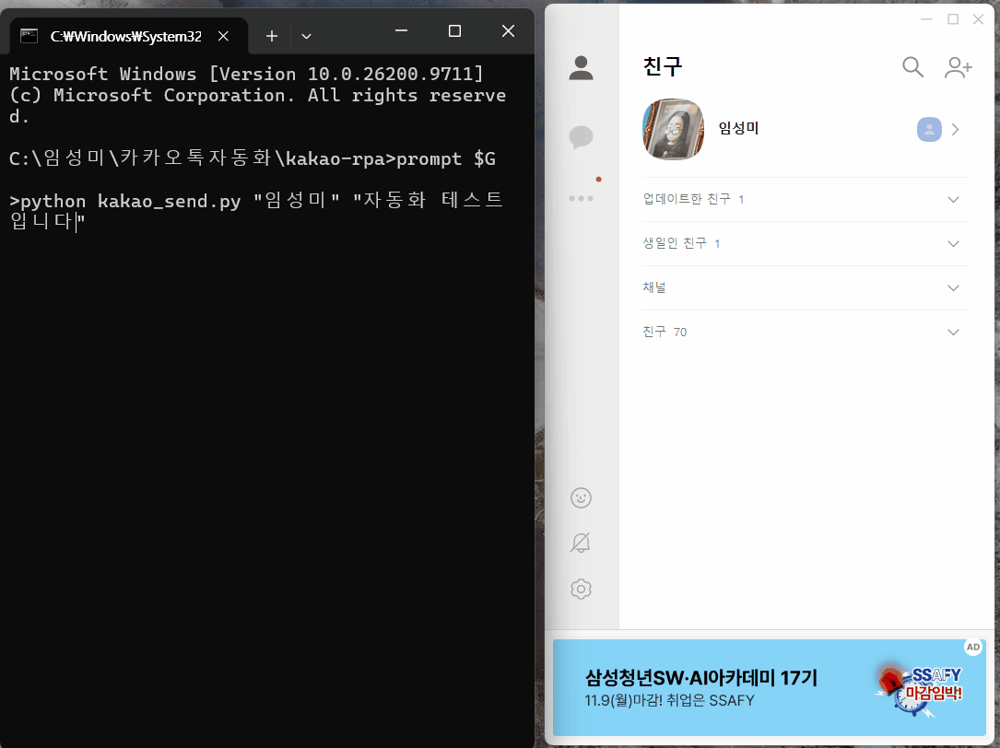
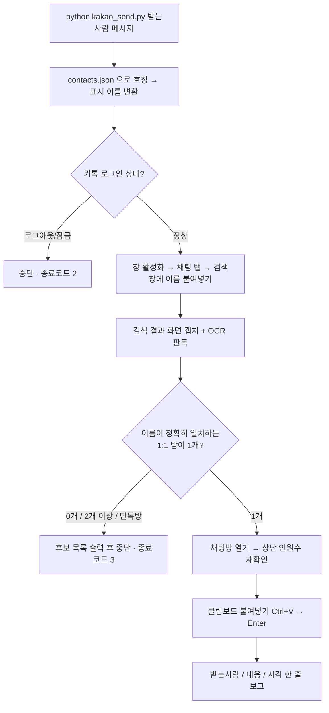

# kakao-rpa

> Windows 카카오톡 PC 앱을 Python으로 제어해 **1:1 채팅방에 안전하게 메시지를 보내는 RPA 도구** — 반복 업무 자동화에 관심 있는 회계 직무 지원자의 학습 프로젝트입니다.

## 데모




## 만든 이유

회계 업무는 거래처 확인 요청, 마감 일정 공유, 증빙 요청처럼 **같은 내용을 반복해서 전달하는 일**이 많습니다. 사람이 하면 수신자를 잘못 고르는 실수가 생기기 쉬워서, 자동화하되 **"잘못된 곳에 보내지 않는 것"을 최우선 요건**으로 두고 RPA 도구를 직접 만들어 보았습니다. 카카오톡은 임의의 친구·채팅방에 메시지를 보내는 공식 API를 제공하지 않아 UI 자동화로 접근했습니다.

## 동작 방식



- 창 제어: `pywinauto`(win32 백엔드), 마우스·키 입력 보완: `pyautogui`
- 한글 입력: 키보드 타이핑 대신 `pyperclip` + `Ctrl+V` (끝나면 기존 클립보드 복원)
- 각 단계 사이 0.5~1초 대기

## 안전장치 설계

| 규칙 | 구현 |
|---|---|
| **수신자가 정확히 1명일 때만 전송** | 검색 결과 중 이름이 일치하는 1:1 방이 1개가 아니면 보내지 않고 후보 목록을 출력 |
| **단톡방 제외** | 목록에서 이름 옆 인원수 표시가 있는 방은 제외, 방을 연 뒤 상단 헤더에서 한 번 더 확인 |
| **취지만 주면 확인 후 전송** | "정중하게 거절해줘"처럼 취지만 받으면 문장을 먼저 보여주고 승인 후에만 실행 (문장을 그대로 받으면 즉시 전송) |
| **로그아웃 시 정지** | 로그인·잠금 화면이면 중단하고 사용자에게 알림. 비밀번호는 절대 입력하지 않음 |
| **판독 불가 시 안전 중단** | OCR이 이름을 못 읽으면 "0개"로 처리해 보내지 않음 (fail-safe) |
| **결과 보고** | 전송 후 `받는사람 \| 내용 \| 시각`을 한 줄로 출력 |

`--dry-run` 옵션으로 검색·판정까지만 하고 전송하지 않을 수 있습니다.

## 문제 해결 기록

개발 중 실제로 겪은 문제들입니다.

| # | 문제 | 원인 | 해결 |
|---|---|---|---|
| 1 | 검색 결과 목록의 항목을 코드로 읽을 수 없음 | 카카오톡 목록이 직접 그린(owner-drawn) 컨트롤이라 pywinauto/UIA 트리에 항목이 없음 | 결과 영역을 캡처해 Windows OCR(`winocr`)로 판독하고, 이름·인원수 표시로 1:1/단톡방 구분 |
| 2 | 검색 중 **"친구 추가" 창이 의도치 않게 열림** | 카톡에서 `Ctrl+A`가 입력창 전체선택이 아니라 '친구 추가' 단축키 | 단축키를 쓰지 않고 `End` + `Backspace`로 입력창을 비움 (아무것도 추가되지 않은 채 창을 닫음) |
| 3 | 검색어가 `이전텍스트 홍길동`처럼 이전 내용과 섞임 | 검색창이 비워지지 않은 상태에서 붙여넣기 | 붙여넣기 전 항상 입력창 비우기, 종료 시에도 검색창 정리 |
| 4 | OCR 결과에 시간이 이름에 붙음 (`이름 오우`) | 같은 줄의 시간 텍스트가 이름과 합쳐짐 | 합치기 전에 오른쪽 시간·배지 열의 단어를 먼저 제외 |
| 5 | 단톡방 인원수(`6`)가 별도 줄로 인식됨 | OCR이 이름과 숫자를 다른 줄로 분리 | y좌표가 비슷한 줄은 하나로 병합한 뒤 "이름 + 숫자" 패턴으로 단톡방 판정 |
| 6 | 이모지로만 된 방 이름이 숫자 `4`로만 읽힘 | OCR이 이모지를 못 읽음 | 숫자만 읽힌 행은 이름 불명 단톡방으로 처리해 제외 |
| 7 | "나와의 채팅"이 `O홍길동`로 읽혀 0개로 판정 | 이름 앞 '나' 배지 아이콘을 문자로 오인 | 앞에 `O/0/나` 한 글자가 붙은 경우에 한해 일치로 허용 |
| 8 | 화면 캡처 좌표와 창 위치가 어긋남, 다른 창이 가림 | DPI 배율 / 창이 이동·가려짐 | DPI-aware 설정, 매 실행마다 창 실제 좌표 조회 + 창 활성화 |
| 9 | 콘솔에서 한글 창 제목이 깨져 보임 | 콘솔 기본 인코딩(cp949) | 출력을 UTF-8로 재설정 |

## 회계 업무 적용 계획

현재는 메시지 전송 단계까지만 구현했고, 아래는 **앞으로 확장해 보려는 계획**입니다.

- **엑셀 전표 → ERP 입력 자동화**: 엑셀 전표 데이터를 읽어 ERP 입력 화면에 반복 입력. 같은 "화면 제어 + 클립보드 입력 + 단계별 검증" 구조를 재사용하고, 입력 전 차대변 합계 일치 같은 검증을 먼저 수행
- **거래내역 대사**: 은행 거래내역과 장부(엑셀)를 금액·일자·거래처로 매칭해 불일치 항목만 목록화하고, 담당자에게 확인 요청 메시지 발송
- **마감 알림·증빙 요청**: 마감 일정, 미제출 증빙 요청을 정해진 수신자에게 정해진 문구로 발송
- 공통 원칙: **사람이 확인하는 지점(승인)을 남기고, 모호하면 실행하지 않는 구조**

## 배운 점

- UI 자동화는 "되게 만드는 것"보다 **"잘못 실행되지 않게 막는 것"**에 설계 비용이 더 든다는 점 (fail-safe 기본값)
- 접근성 트리가 없는 화면은 화면 캡처 + OCR로 우회할 수 있지만, 오인식을 전제로 **판독 실패 = 중단**으로 설계해야 함
- 앱별 단축키(`Ctrl+A` 등)가 일반적인 기대와 다를 수 있어, 자동화 전에 단계별로 화면을 확인하며 검증해야 함
- 실제 대상에 보내기 전에 `--dry-run`과 "나와의 채팅"으로 먼저 검증하는 습관

## 설치 및 사용법

요구사항: Windows 11, 카카오톡 PC 앱(자동 로그인 상태), Python 3.10+, Windows 한국어 OCR 언어팩

```bash
pip install -r requirements.txt
copy contacts.example.json contacts.json   # 본인 환경에 맞게 수정 (contacts.json 은 git 에 올라가지 않음)
```

```bash
python kakao_send.py "받는사람" "메시지"
python kakao_send.py "받는사람" "메시지" --dry-run   # 전송 없이 검색·판정만
```

- `contacts.json`: `{"호칭": "카톡 표시 이름"}` 형식 (예: `{"친구A": "홍길동"}`)
- 카카오톡 기본 경로가 다르면 `kakao_send.py`의 `KAKAO_EXE`를 수정
- 종료 코드: `0` 성공 · `2` 로그아웃/잠금 · `3` 대상 불명확(미전송) · `4` 기타 오류
- 실행 중에는 마우스·키보드를 건드리지 마세요 (마우스를 화면 모서리로 옮기면 중단)

## 주의사항

**개인 학습용이며 대량·스팸 발송 용도로 사용하지 않습니다.** 카카오톡 UI 자동화는 공식 지원 방식이 아니므로 사용에 따른 책임은 사용자에게 있으며, 본인이 허락받은 상대에게만 보내세요.
